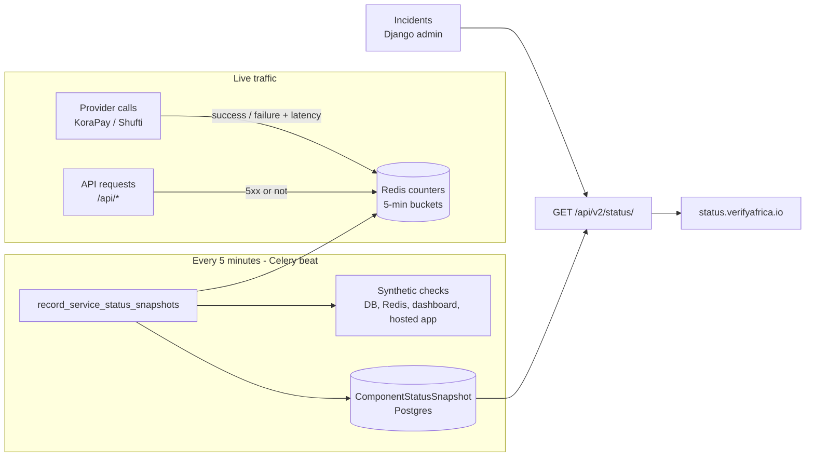
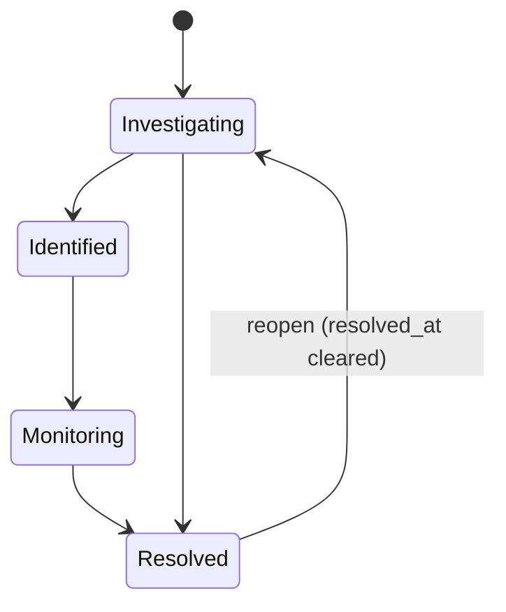

# VerifyAfrica Status Page

Public page at `status.verifyafrica.io` showing whether each part of VerifyAfrica is usable right now, its 90-day uptime, and current and past incidents.

There are two parts:

| Part | Location | Role |
|---|---|---|
| Backend | `backend-main/src/service_status/` | Measures health, stores history, serves the API |
| Frontend | `monorepo/apps/status/` | Displays it (this app) |

---

## 1. How it works



### 1.1 What gets measured

Each row on the page is a **component**. They are defined in `service_status/components.py`.

| Group | Components | Signal |
|---|---|---|
| Platform | Public API | Share of `/api/*` requests that returned 5xx, plus a database and Redis check |
| Platform | Client Dashboard, Hosted Verification | HTTP GET of `CLIENT_APP_URL` / `VERIFY_APP_URL` |
| Platform | Background Processing | Whether the 5-minute job is still running (see staleness below) |
| Verification Products | Document, Facial, Address, AML, Business AML, KYB, Crypto Wallet, Risk Assessment | Outcomes of real Shufti calls |
| Government Registry | Nigeria, Ghana, Kenya, Côte d'Ivoire, South Africa, United States | Outcomes of real KoraPay calls, grouped by the country prefix of the verification type (`ng_`, `gh_`, …) |

**No paid test calls are made.** Product health comes only from real customer traffic.

### 1.2 Recording provider calls

Provider calls are wrapped in `track_provider_call(verification_type)` from `service_status/recorder.py`. This happens in two places:

- `VerificationService.initiate()` in `verifications/verification_service.py`. This covers API, dashboard, bulk and hosted-link submissions.
- The Shufti submit in `verifications/new_verify.py`.

Each call increments a Redis hash at `service_status:calls:{component}:{bucket}`. A bucket is a 5-minute window, and each hash expires after 3 hours. The hash stores `total`, `failed` and `latency_ms_sum`.

A call is only counted as a **failure** when the problem is on our side or the provider's:

| Outcome | Counted as |
|---|---|
| Success | OK |
| Provider 400 / 422 (bad input), `NotFound`, `ValueError`, validation errors | OK, because the system worked and the input was wrong |
| Provider 5xx, provider 429 (rate limited) | Failure |
| Timeout, connection error | Failure |
| Any other unexpected exception (including bugs in our code) | Failure |

`RequestLoggingMiddleware` counts every `/api/*` response against the `api` component, and anything 5xx is a failure.

Recording never raises. If Redis is down, the verification still goes through and the count is lost.

### 1.3 The 5-minute rollup

The Celery beat task `service_status.tasks.record_service_status_snapshots` runs every 5 minutes, at `*/5`. On each run it:

1. Looks at the last **6** completed 5-minute windows. This lets it catch up after a few missed runs.
2. For each component and window that has **no snapshot yet**, reads the Redis counts and computes a status.
3. Runs the synthetic checks once and applies them to the most recent window only, because a check can't be replayed for the past:
   - **Database:** runs `SELECT 1`.
   - **Redis:** sends `PING`.
   - **Dashboard and hosted app:** HTTP GET with a 10 s timeout. A 5xx or no response is a major outage, and a response slower than 5 s is degraded. These checks are skipped unless the URL is `https://`, so they don't run locally.
   - If the database or Redis fails, the Public API is marked as a major outage.
4. Writes one `ComponentStatusSnapshot` row per component per window.
5. Clears the cached summary.

A second task, `prune_service_status_snapshots`, runs daily at 02:30 and deletes snapshots older than 91 days.

### 1.4 Status thresholds

Each window is judged on its own, in `evaluate_traffic` in `service_status/services.py`:

| Status | Rule |
|---|---|
| Operational | Fewer than 2 failures, or no traffic |
| Degraded performance | 2 or more failures and an error rate of 5% or more |
| Partial outage | 2 or more failures and an error rate of 25% or more |
| Major outage | 3 or more failures and an error rate of 50% or more |
| Under maintenance | Only ever set by an incident |

A single failed call is always treated as noise. All the thresholds are constants at the top of `services.py`.

### 1.5 What the page shows

`GET /api/v2/status/` is public, needs no auth, and returns:

- **Current status per component:** taken from the component's latest snapshot. Any open incident can make it worse (see section 2).
- **Overall status:** the worst status across all components. This drives the coloured banner.
- **90-day history per component:** one bar per day, in UTC.
  - Daily uptime is `1 − (major_outage_windows + 0.5 × partial_outage_windows) / windows_recorded`.
  - Degraded and maintenance windows count as up.
  - A bar's colour is the worst status seen that day. Grey means no data.
  - The headline uptime percentage is the average of the days that have data.
- **Staleness:** if the newest window ended more than **15 minutes** ago, the summary sets `is_stale` and Background Processing shows as a major outage. The page then shows a "Status checks are delayed" warning.
- **Active and past incidents:** see section 2.

`GET /api/v2/status/health/` returns `200` or `503` based on the database and Redis. Point external uptime monitors and load balancers at it.

### 1.6 Caching and refresh

| Layer | Duration |
|---|---|
| Redis summary cache (`service_status:summary`) | 60 s, and cleared after every rollup |
| HTTP `Cache-Control: public, max-age=30` | 30 s |
| Frontend refetch (`useStatusSummaryQuery`) | Every 60 s, and when the tab regains focus |

The summary is public data with no credentials, so the endpoint also sends `Access-Control-Allow-Origin: *`. That way the status subdomain can always read it, even if production overrides `CORS_ORIGIN_WHITELIST`.

---

## 2. Incidents

Incidents are how a person tells users what is going on. You manage them in **Django admin, under Service status → Incidents**.

### 2.1 Fields

| Field | Meaning |
|---|---|
| `title` | Headline, e.g. "KoraPay Ghana SSNIT lookups failing" |
| `status` | Investigating → Identified → Monitoring → Resolved |
| `impact` | Status forced onto the affected components while the incident is open: Degraded, Partial outage, Major outage or Under maintenance |
| `components` | Which rows it affects (multi-select of component keys) |
| `is_public` | Untick to keep an incident internal; it then never appears on the page |
| `started_at` | Defaults to now; editable, so you can backdate it |
| `resolved_at` | Set **automatically** when status becomes Resolved, and cleared if the incident is reopened |
| Updates (inline) | Timestamped messages, each with its own status, e.g. "Monitoring: fix deployed, error rate back to normal" |

### 2.2 Lifecycle



### 2.3 How open incidents affect the page

An incident is **active** while it is public and its status is not Resolved. While active:

- It is listed under **Active incidents** at the top, with its updates newest first.
- Each listed component shows the **worse** of its computed status and the incident's `impact`. An incident can make a status worse, never better. Posting "Degraded" over a computed "Major outage" still shows Major outage.
- The overall banner reflects this, because it is the worst component.
- An incident with **no components** is shown in the list but changes no statuses.

Use `Under maintenance` as the impact for planned work. It turns the banner blue ("Scheduled maintenance in progress") without counting as downtime.

### 2.4 Past incidents

- When you set the status to **Resolved**, `resolved_at` is filled in and the incident moves to **Past incidents**.
- Past incidents show resolved, public incidents whose `resolved_at` falls within the **last 14 days** (`RECENT_INCIDENT_DAYS`).
- After 14 days an incident drops off the page but stays in the database. There is no archive page yet.
- Each card shows the start time, the resolve time, the affected components and the full update timeline.

### 2.5 Recommended workflow

1. An alert fires, or you see the component go red on the page.
2. Create an incident: set `status = Investigating`, choose the impact and components, and add a first update.
3. Add an update at each step (Identified, then Monitoring).
4. Set the status to **Resolved** and add a final update explaining the cause and the fix.

---

## 3. Known issues and limitations

### 3.1 Detection gaps

| Issue | Effect | Possible fix |
|---|---|---|
| **No traffic means no signal.** A product nobody uses in a window is "Operational" by default. | A provider can be down overnight and the page stays green until someone tries it. | A cheap free provider check, if one exists (e.g. a balance endpoint), or occasional paid probes for key products. |
| **Only the first submission is tracked.** Shufti webhooks (`request.timeout`, `request.invalid`, …), status syncs (`get_verification_data`) and later polling are not counted. | Failures that happen asynchronously after a successful submit don't show up. | Wrap those calls and webhook outcomes with `record_call`. |
| **Classifying errors is heuristic.** A provider outage that comes back as a 400/422, or KoraPay's normal 404 "identity not found", counts as OK. A bug in our own code counts as a provider failure. | Some false negatives and false positives. | Refine `is_system_failure` as real cases appear. |
| **One bad endpoint can mark the whole API down.** Every `/api/*` route counts towards the Public API component. | A single route returning 5xx under load can show the whole API as degraded. | Weight or exclude non-critical routes, or split the API into several components. |
| **Celery retries are counted again.** A retried task that fails each time adds several failures. | The error rate looks worse than what users actually see. | Count only the final attempt. |
| **Synthetic checks run from the API server.** The dashboard and hosted app are checked from inside the same network, and only their home pages. | Regional DNS or CDN problems may be missed. | An external monitor such as BetterStack or UptimeRobot. |
| **Test environments use sandbox credentials.** | Status on `test.status` says nothing about production providers. | Expected; treat test status as informational. |

### 3.2 Accuracy of history and uptime

| Issue | Effect |
|---|---|
| **Gaps are not counted as downtime.** If the whole server, database or Celery is down, no snapshots are written, and uptime is computed only from windows that *were* recorded. | A total outage can look like **100% uptime** for that day. This is the biggest accuracy issue. Fix: count expected windows (288 per day) minus recorded ones as downtime, or record outages from an external monitor. |
| **Incidents don't affect history.** Uptime bars come only from snapshots. | A manually declared outage with green computed snapshots still shows a green day. |
| **Each 5-minute window is judged separately.** There is no smoothing and no rule requiring several bad windows before changing status. | A short burst can flip a component red for one window, and status can flap between windows. A 3-minute outage may be missed or shown for 5 minutes. |
| **The "current status" lags.** It is the last *completed* window. | Up to about 5 minutes late, plus the caching in section 1.6. |
| **One bad window colours the whole day.** | A day at 99.7% uptime can show a red bar. The tooltip shows the real percentage. |
| **Days are in UTC.** | For West Africa (UTC+1) the day boundaries are an hour off. |
| **Recent snapshots can't be recalculated.** A window is written once and never rewritten. | Changing thresholds affects only future windows. |

### 3.3 Infrastructure dependencies

| Issue | Effect |
|---|---|
| **Redis is critical.** It holds the counters, the cache and the Celery broker. | If Redis is down, counts are lost and the rollup can't run, so the page goes stale and history has a gap (see the first row in 3.2). |
| **Same backend.** The status app is a separate frontend, but its data comes from the same API and database. | If the API is down, the page shows "We couldn't load the system status" instead of a proper outage notice. Monitor `/api/v2/status/health/` externally. A static fallback (e.g. a last-known JSON file on a CDN) would help. |
| **There must be exactly one beat process.** | Two beat schedulers can race on the same windows. The unique constraint on `(component, window_start)` stops duplicate rows, but the losing run raises `IntegrityError` and skips the rest of that run. Fix: use `get_or_create` / `ignore_conflicts` for snapshot writes. |
| **Incidents can take up to about 2.5 minutes to appear.** Saving an incident doesn't clear the summary cache. | Up to 60 s Redis cache + 30 s HTTP cache + 60 s frontend refetch. Fix: a `post_save` signal on `Incident` / `IncidentUpdate` that deletes `service_status:summary`. |
| **Storage.** There are about 18 components × 288 windows × 90 days, roughly 470k rows. | Fine for Postgres with the existing index; pruned daily. |

### 3.4 Maintenance gotchas

- **New verification types must be mapped.** Add each new type to `component_for_verification_type` in `components.py`, or it is silently ignored (as `two_fa_verification` is today). A new KoraPay country also needs a new `registry_xx` component.
- **Renaming a component key orphans its data.** Old snapshots and any incident `components` entries still use the old key.
- **Thresholds are code constants, not settings.** Changing them needs a deploy.
- **Past incidents older than 14 days are hidden.** There is no "incident history" page yet.

---

## 4. Running locally

```bash
# backend (Docker): worker + beat must be running for snapshots to appear
cd backend-main && just up

# record a snapshot immediately instead of waiting for beat
docker exec backend-main-django-1 python manage.py shell -c \
  "from service_status.services import record_status_snapshots; print(record_status_snapshots())"

# frontend
cd monorepo && bun dev:status   # https://status.verifyafrica.localhost
```

The app reads `VITE_API_BASE_URL` from `apps/status/.env`; see `.env.example`.

Backend tests: `docker exec -e TESTING=1 backend-main-django-1 python manage.py test service_status`

## 5. Deploying

1. Add DNS for `status.verifyafrica.io` (and `test.status.verifyafrica.io`).
2. Build with `VITE_API_BASE_URL` set (`bun build:status`), then run `bun run .output/server/index.mjs`.
3. Ideally host it separately from the API server.
4. Point an external uptime monitor at `https://api.verifyafrica.io/api/v2/status/health/`.
